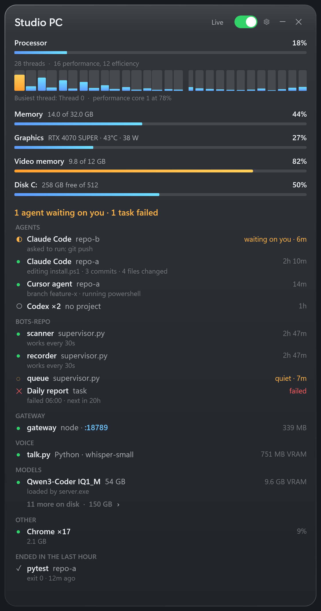

# Desktop Vitals

Task Manager is not enough in the age of AI. Desktop Vitals is a small glass window for Windows that shows what your PC is doing: scripts, bots, scheduled tasks, local AI, and system load.

It does not kill any tasks. It only reads and shows. It never starts, stops, or kills other programs.

When you want to open something, it links out to your IDE or File Explorer.

It needs no setup. Open it and it finds what is running on your machine.



## What it can and can't do

- It only reads what is already on the machine and shows it.
- It never starts or stops programs, tasks, or services.
- It uses no network except optional http health checks to `127.0.0.1`, `::1`, or `localhost`.
- It never needs admin rights.
- Unexpected errors append to `%APPDATA%\DesktopVitals\errors.log`.

## What it shows

- **System:** processor load, with a bar for every thread, grouped into performance and efficiency cores when the CPU reports them; memory; graphics load and video memory; free space on the system drive. NVIDIA cards also show temperature and power.
- **Scripts:** every script an interpreter is running from your own files, one line per script, with how long it has been up, its CPU and its memory. This covers Python (including `python -m`), Node, Bun, Deno, PowerShell, batch files, Windows Script, Ruby, PHP, Perl and Java. Scripts that belong to installed apps or to Windows are left out.
- **Starts with Windows:** everything that launches when you sign in: the Startup folder, Startup apps, and tasks set to run at sign-in. It shows which are running, with their CPU and memory. Anything you turned off in Task Manager's Startup apps is left out.
- **Scheduled:** tasks that run at set times, created by you or your tools, not Windows' own or app updaters. It shows which are running now, which failed their last run, when each last ran, and when each runs next.
- **AI:** everything AI on the machine in one card, each line tagged with what it is:
  - **Agent:** command-line agents such as Claude Code, Codex, Gemini CLI, OpenClaw and Aider. For agents with one process per session it shows how many sessions are open; hover to see the folder each one works in.
  - **App:** AI desktop apps such as Claude, ChatGPT, Cursor, Windsurf and Grok.
  - **Model:** every model installed on the PC, loaded or not. It looks in `models` folders at a drive root or in your user folder, and in the Hugging Face, Ollama and LM Studio stores. Add a folder with `@models = D:\my-models`. A model in use shows what is using it (a server and its port, or the script that loaded it) and how much video memory that holds. One that isn't loaded shows its size, or "new today". A script or model server holding 1 GB or more of video memory with no model found for it gets its own line, so nothing big on the GPU goes unexplained. Running model servers (llama.cpp `llama-server`, Ollama, LM Studio, koboldcpp, vLLM) show too.
  - **Bot** and **Pinned:** your own bots and pinned apps that are AI (see [Settings](#settings)).
- **Bots** and **Pinned:** optional cards you set up yourself. See [Settings](#settings).
- **Top apps:** the busiest apps, grouped, so all Chrome processes count as one line. Click **CPU** or **Memory** to sort.

Hover over a line to see what a click will do:

- **Open in Cursor** or **Open in VS Code** opens a script or folder in your editor, whichever one is installed.
- **Show in File Explorer** opens the program's folder with the file selected.

## Install

```powershell
irm https://raw.githubusercontent.com/degconsultinggroup/desktop-vitals/main/install.ps1 | iex
```

You need Windows 10 or 11.

### Install with your AI agent

Paste https://github.com/degconsultinggroup/desktop-vitals into Claude Code, Codex, Cursor, or Gemini CLI and say "install and open this".

### Download the exe

1. Open the latest [GitHub Release](https://github.com/degconsultinggroup/desktop-vitals/releases).
2. Download `DesktopVitals.exe` and `SHA256SUMS.txt`.
3. Compare `Get-FileHash -Algorithm SHA256 .\DesktopVitals.exe` to the hash in `SHA256SUMS.txt`. Stop if they differ.
4. Run the exe. No installer and no admin prompt.

The exe is not code-signed yet. Windows SmartScreen may say "Windows protected your PC". Click **More info**, then **Run anyway**.

### Build from source

```powershell
git clone https://github.com/degconsultinggroup/desktop-vitals.git
cd desktop-vitals
powershell -ExecutionPolicy Bypass -File .\build.ps1
```

`build.ps1` builds `bin\DesktopVitals.exe`. The build uses the C# compiler that ships with Windows, so there is nothing else to install. `install.ps1` downloads the latest release instead of building.

## First run

The first time it opens, the board fills with what is already running. Then **Here's what I found** lists everything it detected and everything in your settings, grouped by kind. Untick a line to hide it; click a tag to change its kind. **Looks good** saves those answers to `%APPDATA%\DesktopVitals\review.txt`. The gear button at the top brings this screen back any time.

## Use

- **Ctrl+Alt+P** opens the window. Press it again while the window is in front to tuck it away.
- The **Live** switch turns readings on and off. When it is off, or the window is minimized, the app does no work.
- The refresh button looks again for new scripts, models, tasks and settings. It also does this on its own.
- **Esc** or **×** closes it. Nothing starts at logon.

While live, it uses about 1-2% of a typical 4-core machine in CI soak (lower on quieter desktops). One system call per refresh covers every process.

## Settings

Everything works without settings. To add your own Pinned or Bots lines, or an optional temperature file, copy `watch.example.txt` to `%APPDATA%\DesktopVitals\watch.txt`, edit it, and reopen the app. Your settings stay outside the app folder, so updates never touch them.

- **Pinned:** `Label = match` keeps an eye on an app or a command. A match ending in `.exe` is a process name. Anything else is text found in the command line.
- **Bots:** add `| check:` to a line to track whether a bot is still doing work, not just running. The check is a file the bot rewrites, a folder it writes into, or a local http health address (`127.0.0.1`, `::1`, or `localhost` only). A bot turns amber when its check goes quiet for 5 minutes. Add `| code:` to open its folder in your editor.
- **AI:** lines that name a known AI program (Claude, Cursor, Ollama, OpenClaw ...) go in the AI card instead of Bots or Pinned. Add `| ai` to put any other line there, and `| kind: Agent` (or `App`, `Model`, `Bot`, `Watching`) to choose its tag (`Watching` shows as Pinned).
- **Hidden and re-tagged items:** the review screen writes `@hide = <name>` and `@kind = <name> | Agent` into `review.txt`. Delete those lines to undo them.
- **Processor temperature:** Windows doesn't give CPU temperature to normal apps. If a sensor tool already writes a JSON file, point `@temperature-file` at it. Desktop Vitals only reads that file; it never starts a sensor task.

`watch.example.txt` explains each one with examples.

## Snapshot for scripts and AI agents

```powershell
DesktopVitals.exe --version
DesktopVitals.exe --json
DesktopVitals.exe --snapshot C:\some\folder
```

`--version` prints `0.1.1` and exits. `--json` prints UTF-8 JSON and exits: `strip` is the machine line (processor, memory, graphics, video memory, disk) and `lines` is every line on the board (`section`, `name`, `kind`, `state`, `cpu`, `ram_mb`, `vram_mb`, `folder`). If there is no console, `DesktopVitals.exe --json C:\some\folder\vitals.json` writes that file.

Add `--review` to picture the review screen instead, and `--width 1200` to picture a wider window. `--snapshot` takes a reading off screen, writes `vitals.txt` (a plain-text report) and `vitals.png` (a picture of the full window) to that folder, and exits. It takes about 5 seconds and doesn't disturb an open window. A chat bot or an AI agent can run it to answer "how's my PC doing?" with text or a screenshot.

In `vitals.txt`, bots are marked `[ok]`, `[QUIET]` (running but no sign of work for 5 minutes) or `[DOWN]` (not running).

## Build notes

The whole app is one file, `src\DesktopVitals.cs`, a WPF window written for the C# 5 compiler in `%WINDIR%\Microsoft.NET\Framework64\v4.0.30319`. `build.ps1` shows the exact compiler call. Setting `DESKTOPVITALS_NO_NVML=1` before starting it shows the graphics readings that AMD and Intel owners get.

## Tested on

- PASS: GitHub Actions `windows-latest` (x64) smoke
- PASS: GitHub Actions `windows-11-arm` (x64 exe under emulation); cores flat on that image
- PASS: Windows 11 desktop, i7-14700F, RTX 4070 SUPER, with Claude Code, Codex, Cursor, bots and local models running
- Not tested yet (no lab machine): Windows Sandbox / fresh non-admin no-NVIDIA; German UI; Defender / VirusTotal; Windows 10 22H2

## License

MIT. See [LICENSE](LICENSE).

Made by [Frontier Deployments](https://frontierdeployments.com).
